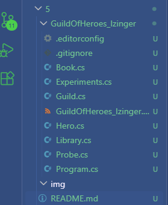
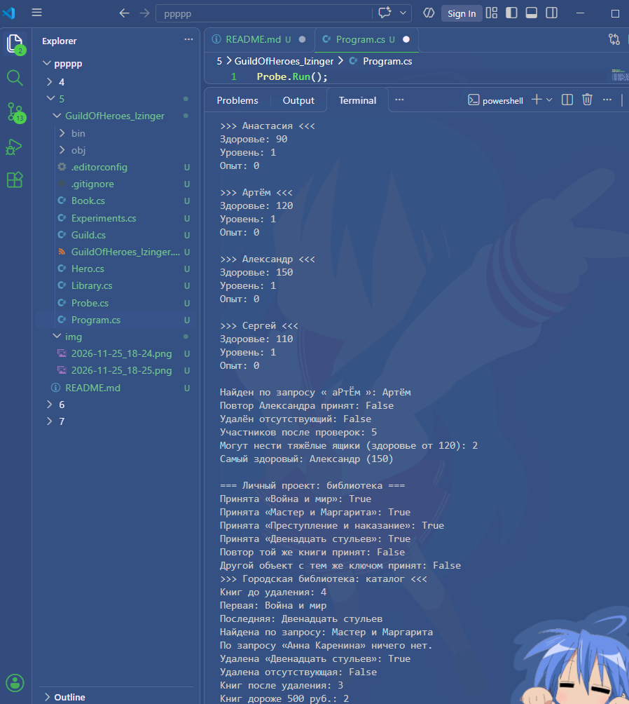

# Практическая работа № 13

Автор: Изингер Алексей  
Группа: ИСП-242  

## Приложение 


Проект: `GuildOfHeroes_Izinger` — консольное приложение на C# (.NET 9).  
Личный проект («Собственный проект»): **«Библиотека»** — классы `Book` и `Library`.

## Состав архива

```text
5
├── GuildOfHeroes_Izinger
│   ├── .editorconfig
│   ├── .gitignore
│   ├── Book.cs
│   ├── Experiments.cs
│   ├── Guild.cs
│   ├── GuildOfHeroes_Izinger.csproj
│   ├── Hero.cs
│   ├── Library.cs
│   ├── Probe.cs
│   └── Program.cs
├── img
|
└── README.md
```


## Запуск

Нужен .NET SDK 9. 

```bash
cd GuildOfHeroes_Izinger
dotnet build
dotnet run
```

Основной сценарий выводит сначала результат работы с героями, затем блок «Личный проект: библиотека». Пробы, трассировки, примеры «двух ошибок» и дополнительная часть собраны в `Experiments.cs`: чтобы их выполнить, уберите `//` перед `Experiments.Run();` в начале `Program.cs`, запустите `dotnet run`, после проверки верните `//`. Файл `Probe.cs` по правилу курса содержит в `Run` одну строку, а `// Probe.Run();` закомментирована.

## Практическая работа №5

Тема: закрытый состав, поиск и `null`. `Hero.cs` не менялся. `Guild` теперь сам отвечает за состав: закрытое поле `_heroes`, вычисляемое свойство `MemberCount`, методы `AddHero`, `FindHeroByName`, `RemoveHero`, `GetMembers`, `CountHealthy`, `FindStrongest` (и `SelectHealthy` из дополнительной части). Публичного списка `Heroes` больше нет; в `Program.cs` нигде не осталось `guild.Heroes`.

Правило гильдии: двух героев с одинаковым именем быть не может; имена сравниваются без пробелов по краям и без учёта регистра (`StringComparison.OrdinalIgnoreCase`).

### Ответы на вопросы

1. **Кто теперь проверяет повтор при добавлении и почему не `Program`?** Сама `Guild`: `AddHero` вызывает `FindHeroByName` и отказывает, если герой с таким именем уже есть. Если бы проверка жила в `Program`, она работала бы только там, где о ней вспомнили; любой другой код мог бы добавить кого угодно. Внешний код просит, гильдия решает.
2. **Когда `FindHeroByName` возвращает `null`?** Если запрос пустой или состоит из пробелов, а также если после просмотра всех героев совпадения нет. `null` — отсутствие ссылки на героя, а не «пустой герой».
3. **Зачем очищать запрос, если имена героев уже очищены?** Имена героев нормализует конструктор `Hero`, а запрос приходит снаружи (« аРтЁм ») и через конструктор не проходит. `Trim()` убирает пробелы запроса, а режим `OrdinalIgnoreCase` снимает зависимость от регистра.
4. **Почему `MemberCount` не хранит число, а вычисляет его?** Каждое чтение берёт актуальное `_heroes.Count`. Второго счётчика, который можно забыть обновить, нет, поэтому расхождение невозможно.
5. **Удаление из гильдии уничтожает героя?** Нет. `RemoveHero` убирает ссылку из состава; объект продолжает жить, пока на него ссылается переменная (проба: «Объект жив: Учебный воин, 150»).
6. **Почему `private`-поле не защищено, если вернуть его из метода?** `private` скрывает имя поля, но не сам объект. Метод, возвращающий `_heroes`, отдаёт наружу ссылку на тот же список, и вызывающий может сделать `Clear()`. Поэтому `GetMembers` возвращает новый список с теми же ссылками на героев.

### Ход работы

- Этап 1. Проба показала проблему: пока список открыт, `probeGuild.Heroes.Clear()` обнуляет состав (`До: 2`, `После Clear: 0`). Эта проба выполнялась на версии `Guild` из №4 и после закрытия списка воспроизвести её нельзя.
- Этапы 3–4. `Guild.cs` заменён версией с закрытым `_heroes`; `Program` переведён на `AddHero`, `GetMembers`, `MemberCount`, индексы берутся у `members`. Вывод совпал с итогом №4.
- Этапы 5–6. Написан `FindHeroByName` (пустой запрос → `null`, `Trim()`, сравнение без учёта регистра; `return hero` внутри `if`, `return null` после цикла). `AddHero` сначала проверяет, потом меняет состав. Запрос « аРтЁм » находит «Артём»; повтор Александра: `False`.
- Этап 7. `RemoveHero` удаляет найденную ссылку: «Удалён отсутствующий: False», участников 5. Проба приёма/повтора/удаления выполнена (см. вывод экспериментов).
- Этап 8. Проба с копией: `copy.Clear()` очищает только копию (в гильдии остаётся 2), а `again[0].TakeDamage(50)` меняет самого героя (здоровье воина в гильдии 100): копия списка, но те же объекты.

### Трассировка (этап 9)

Прогноз до запуска:

```text
True
False
True
True
1
2
True
```

Создано объектов `Hero`: **3** (`new Hero` встречается три раза). В гильдии в итоге остался **один** — «Второй»: «Первый» удалён, а второй `Hero` с именем « пЕРВЫЙ » гильдия не приняла (отказ не уничтожает объект, он просто не попал в состав).
`snapshot.Count` (2) не совпадает с `MemberCount` (1), потому что `snapshot` — копия, снятая **до** удаления: в ней по-прежнему две ссылки.

Фактический вывод (проба, блок «Этап 9») совпал с прогнозом, расхождений нет.

### Две ошибки (этап 10)

**Ошибка 1. Поиск сдаётся слишком рано.** Первым проверяется первый герой списка. Если он не подошёл, выполняется `return null` — внутри цикла, и метод завершается целиком, до второго героя цикл не доходит. Поэтому «Ярослав» (первый) находится, а «Сергей» — нет. Исправление: убрать `return null` из тела цикла; единственный `return null` остаётся после цикла.

**Ошибка 2. Закрытое поле выдали наружу.** Метод `GetMembers() { return _heroes; }` возвращает ссылку на сам внутренний список. `private` закрывает имя поля, но не объект, если ссылку на него отдали наружу. Проба этапа 8 с таким методом показала бы «В гильдии: 0»: `copy.Clear()` стёр бы настоящий состав. Исправление: вернуть новый список с переложенными ссылками (как в итоговом `GetMembers`).

### Самостоятельный шаг (этап 11)

В `Guild` перенесены правила подсчёта и поиска: `CountHealthy(int minimum)` (локальный счётчик, обход `_heroes`, условие `Health >= minimum`) и `FindStrongest()` (пустой состав → `null`, иначе тот же алгоритм, что в №4). В `Program` остались по одной строке вызова: подсчёт даёт **2**, самый здоровый — **Александр (150)**. Проверка на пустой учебной гильдии: `FindStrongest() == null` → `True`, `CountHealthy(0)` → `0`.

- *Почему `FindStrongest` возвращает `Hero?`, а `CountHealthy` — просто `int`?* У пустой гильдии нет «самого здорового», и нужен способ сообщить «никого нет» — это `null`. Для подсчёта «никого» — это обычное число `0`, поэтому отдельное «ничего» не требуется.
- *Что делает вызывающий код, если пришёл `null`?* Не обращается к `Name` и `Health`, а сначала проверяет `strongest != null` и только в этой ветке выводит результат (иначе — `NullReferenceException`).

### Личный проект: «Библиотека»

`Library` закрыт: поле `_books`, вычисляемое свойство `BookCount`, методы `AddBook` (отказ при повторе ключа, `bool`), `FindBookByTitle` (возвращает `Book?`), `RemoveBook` (`bool`), `GetBooks` (копия списка) и метод-запрос `CountPricierThan(int price)`. `Program` показывает: успешный приём, отказ при повторе, найденную и ненайденную книги (с проверкой на `null`), удаление, количество до и после.

- *Какой ключ выбран и почему?* Название книги (`Title`), сравнение без пробелов по краям и без учёта регистра. Читатель обычно ищет книгу по названию, а название уже нормализовано закрытым полем `_title`.
- *В какой ситуации ключ подведёт?* Название не уникально: разные издания и разные произведения могут называться одинаково («Мастер и Маргарита» в двух изданиях или две разные книги с общим названием). Вторую такую книгу библиотека отклонит, хотя это другой объект. Подведёт и разное написание («Артём»/«Артем», «ё» и «е» — разные буквы).
- *Что вернёт поиск, если объекта нет, и как это обрабатывает `Program`?* `null`. `Program` сначала проверяет `foundBook != null` и только потом читает `Title`, иначе выводит «ничего нет».

### Вывод программы (`dotnet run`)

```text
>>> Гильдия героев: перекличка <<<
Участников: 5
Первый: Ярослав
Последний: Сергей

>>> Ярослав <<<
Здоровье: 100
Уровень: 1
Опыт: 0

>>> Анастасия <<<
Здоровье: 90
Уровень: 1
Опыт: 0

>>> Артём <<<
Здоровье: 120
Уровень: 1
Опыт: 0

>>> Александр <<<
Здоровье: 150
Уровень: 1
Опыт: 0

>>> Сергей <<<
Здоровье: 110
Уровень: 1
Опыт: 0

Найден по запросу « аРтЁм »: Артём
Повтор Александра принят: False
Удалён отсутствующий: False
Участников после проверок: 5
Могут нести тяжёлые ящики (здоровье от 120): 2
Самый здоровый: Александр (150)
```


Вывод личного проекта:

```text
=== Личный проект: библиотека ===
Принята «Война и мир»: True
Принята «Мастер и Маргарита»: True
Принята «Преступление и наказание»: True
Принята «Двенадцать стульев»: True
Повтор той же книги принят: False
Другой объект с тем же ключом принят: False
>>> Городская библиотека: каталог <<<
Книг до удаления: 4
Первая: Война и мир
Последняя: Двенадцать стульев
Найдена по запросу: Мастер и Маргарита
По запросу «Анна Каренина» ничего нет.
Удалена «Двенадцать стульев»: True
Удалена отсутствующая: False
Книг после удаления: 3
Книг дороже 500 руб.: 2
```


### Дополнительная часть

**Д.1. Подборка, а не число.** `Guild.SelectHealthy(int minimum)` возвращает **новый** список героев со здоровьем не меньше порога. Для порога 120: Артём и Александр. После удаления одного элемента из подборки `MemberCount` остался 5, так как подборка — отдельный список, состав гильдии не затронут.

**Д.2. Где граница правила** (результаты проб):

- `AddHero(new Hero("Артем", 100))` при уже принятом «Артёме» — **принят** (`True`): «е» и «ё» — разные буквы, а правило сравнивает строки посимвольно без учёта регистра, но не нормализует «ё».
- `AddHero(new Hero("", 100))` — герой получает запасное имя «Безымянный герой»; первый такой герой принят, второй такой же **отклонён** (одинаковое имя).
- `FindHeroByName("   ")` возвращает `null`: запрос из одних пробелов не содержит имени, и это правильно — иначе поиск «находил» бы кого-то по пустоте.

Весь вывод экспериментов:

```text
##### ПР №5: эксперименты #####

--- Этап 7: приём, повтор и удаление ---
Первый: True
Тот же объект: False
Другой объект, то же имя: False
Участников: 1
Удалён: True
Участников: 0
Объект жив: Учебный воин, 150

--- Этап 8: копия списка ---
В копии: 0
В гильдии: 2
Здоровье воина в гильдии: 100

--- Этап 9: трассировка ---
True
False
True
True
1
2
True

--- Этап 11: пустая гильдия ---
FindStrongest() == null: True
CountHealthy(0): 0

--- Д.1: подборка SelectHealthy ---
В подборке (порог 120): 2
Артём
Александр
После удаления из подборки: подборка 1, MemberCount 5

--- Д.2: границы правила ---
«Артем» через «е» при «Артём»: True
Имя героя с пустым именем: Безымянный герой
Первый безымянный принят: True
Второй безымянный принят: False
FindHeroByName("   ") == null: True
```


## Скриншоты





